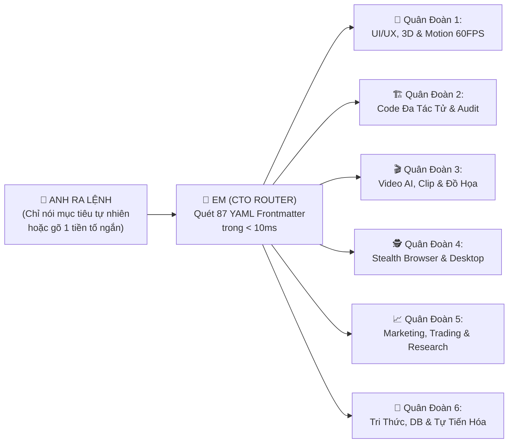

# 🧭 LA BÀN TÁC CHIẾN 87 KỸ NĂNG ANTIGRAVITY 2.0 (MASTER SKILL COMPASS)

> **Chủ quản Tối cao (Owner)**: Anh — Lead Architect / Product Owner  
> **Tác tử Điều phối (CTO & Router)**: Em — Antigravity Senior Engineering Agent  
> **Nguyên tắc Vàng (`Zero-Memorization Invariant`)**: **Anh KHÔNG BAO GIỜ cần nhớ tên kỹ thuật của 87 kỹ năng.** Anh chỉ cần ra lệnh bằng **Ý định Tự nhiên (`Natural Intent`)** hoặc gọi **1 trong 6 Quân Đoàn Thực Chiến** dưới đây — Em sẽ tự động nạp và phối hợp (`Combo Chaining`) đúng bộ kỹ năng mạnh nhất ở tầng nền.

---

## ⚡ 1. CƠ CHẾ TỰ ĐỘNG PHỐI HỢP KỸ NĂNG (`INTENT-TO-SKILL AUTO-ROUTING`)

---

## 🏛️ 2. BẢN ĐỒ 6 QUÂN ĐOÀN THỰC CHIẾN & CÂU LỆNH MẪU CHO ANH

### 🎨 Quân Đoàn 1: Thiết Kế Giao Diện Sáng Đa Tầng, 3D & Chuyển Động 60 FPS
* **Khi nào Anh dùng**: Làm web mới, nâng cấp giao diện sang trọng, thêm hiệu ứng 3D WebGL, con trỏ vật lý hoặc vi tương tác xúc giác.
* **Câu lệnh mẫu Anh chỉ cần nói**:
  * *"Thiết kế cho anh giao diện trang chủ / dashboard này thật sang trọng chuẩn Luminous Light"*
  * *"Thêm hiệu ứng 3D / con trỏ khói / cuộn mượt GSAP 60 FPS vào trang này"*
* **Tổ hợp Kỹ năng Em tự động kích hoạt**:
  * [`design`](file:///C:/Users/game/.gemini/config/skills/design/SKILL.md) + [`taste-engine`](file:///C:/Users/game/.gemini/config/skills/taste-engine/SKILL.md): Định hình Art Direction & chống giao diện AI rập khuôn.
  * [`open-design`](file:///C:/Users/game/.gemini/config/skills/open-design/SKILL.md): Nạp hệ thống màu/chữ từ **153 Thương hiệu lớn** (Apple, Stripe, Linear, Vercel...).
  * [`magic-ui-vault`](file:///C:/Users/game/.gemini/config/skills/magic-ui-vault/SKILL.md) (**84 vũ khí**) + [`react-bits-vault`](file:///C:/Users/game/.gemini/config/skills/react-bits-vault/SKILL.md) (**150 vũ khí**): Bento Cards, Spotlight, Ghost Cursor, Text FX, WebAudioHaptics.
  * [`design-engineering`](file:///C:/Users/game/.gemini/config/skills/design-engineering/SKILL.md) + [`gsap`](file:///C:/Users/game/.gemini/config/skills/gsap/SKILL.md) + [`threejs`](file:///C:/Users/game/.gemini/config/skills/threejs/SKILL.md) + [`r3f-pmndrs`](file:///C:/Users/game/.gemini/config/skills/r3f-pmndrs/SKILL.md) + [`ui-ux-pro-max`](file:///C:/Users/game/.gemini/config/skills/ui-ux-pro-max/SKILL.md).

---

### 🏗️ Quân Đoàn 2: Kiến Trúc Phần Mềm, Lập Trình Đa Tác Tử & Kiểm Toán Độc Lập
* **Khi nào Anh dùng**: Xây dựng hệ thống lớn, sửa bug phức tạp, refactor đa file, chạy sandbox an toàn hoặc kiểm thử nghiệm thu.
* **Câu lệnh mẫu Anh chỉ cần nói**:
  * *"Bung team đa agent làm tính năng X cho anh"* (Kích hoạt ngay 6–12 Pods song song)
  * *"Kiểm toán độc lập và chạy test toàn bộ hệ thống này"*
* **Tổ hợp Kỹ năng Em tự động kích hoạt**:
  * **Quy trình 3 bước**: [`plan`](file:///C:/Users/game/.gemini/config/skills/plan/SKILL.md) (`$plan`) $\to$ [`dev`](file:///C:/Users/game/.gemini/config/skills/dev/SKILL.md) (`$dev`) $\to$ [`test`](file:///C:/Users/game/.gemini/config/skills/test/SKILL.md) (`$test`).
  * **Bản đồ & Tác tử Code**: [`ast-repo-map`](file:///C:/Users/game/.gemini/config/skills/ast-repo-map/SKILL.md) (quét cây cú pháp nén), [`jcode`](file:///C:/Users/game/.gemini/config/skills/jcode/SKILL.md) (Rust Multi-Agent Harness), [`deepseek-reasonix`](file:///C:/Users/game/.gemini/config/skills/deepseek-reasonix/SKILL.md), [`aider-execution-engine`](file:///C:/Users/game/.gemini/config/skills/aider-execution-engine/SKILL.md).
  * **Kỷ luật & Sandbox**: [`tianshu-harness`](file:///C:/Users/game/.gemini/config/skills/tianshu-harness/SKILL.md) (chống trôi mục tiêu CVM), [`failproofai`](file:///C:/Users/game/.gemini/config/skills/failproofai/SKILL.md), [`zeroshot`](file:///C:/Users/game/.gemini/config/skills/zeroshot/SKILL.md), [`e2b`](file:///C:/Users/game/.gemini/config/skills/e2b/SKILL.md), [`opensandbox`](file:///C:/Users/game/.gemini/config/skills/opensandbox/SKILL.md), [`boxlite`](file:///C:/Users/game/.gemini/config/skills/boxlite/SKILL.md).

---

### 🎬 Quân Đoàn 3: Xưởng Phim AI, Cắt Clip Ngắn Tự Động & Đồ Họa Thương Mại
* **Khi nào Anh dùng**: Sản xuất phim/video AI bằng Veo 3.1, cắt video dài thành Shorts/Reels/TikTok, tách nền sản phẩm, hoặc tạo bộ Slide PowerPoint.
* **Câu lệnh mẫu Anh chỉ cần nói**:
  * *"Lên kịch bản và render video Veo 3.1 cho chủ đề..."*
  * *"Cắt video dài này thành các clip ngắn có phụ đề cho TikTok/Reels"*
  * *"Tách nền ảnh sản phẩm này / Tạo bộ slide thuyết trình PowerPoint từ tài liệu này"*
* **Tổ hợp Kỹ năng Em tự động kích hoạt**:
  * **Sản xuất Phim AI**: [`script-factory-pro`](file:///C:/Users/game/.gemini/config/skills/script-factory-pro/SKILL.md) (Veo 3.1 0-credit + 6 Showrunners) + [`waoowaoo`](file:///C:/Users/game/.gemini/config/skills/waoowaoo/SKILL.md) + [`dramaclaw`](file:///C:/Users/game/.gemini/config/skills/dramaclaw/SKILL.md) + [`arcreel`](file:///C:/Users/game/.gemini/config/skills/arcreel/SKILL.md) + [`nano-banana-pro-prompts-recommend-skill`](file:///C:/Users/game/.gemini/config/skills/nano-banana-pro-prompts-recommend-skill/SKILL.md).
  * **Cắt & Dựng Clip Ngắn**: [`autoclip`](file:///C:/Users/game/.gemini/config/skills/autoclip/SKILL.md) (1 link ra clip ngắn + phụ đề) + [`openchatcut`](file:///C:/Users/game/.gemini/config/skills/openchatcut/SKILL.md) (dựng phim đa làn bằng hội thoại).
  * **Ảnh & Slide**: [`background-remover`](file:///C:/Users/game/.gemini/config/skills/background-remover/SKILL.md) + [`photoshop-studio`](file:///C:/Users/game/.gemini/config/skills/photoshop-studio/SKILL.md), [`slide-architect`](file:///C:/Users/game/.gemini/config/skills/slide-architect/SKILL.md) (15,250 mẫu slide) + [`ppt-master`](file:///C:/Users/game/.gemini/config/skills/ppt-master/SKILL.md).

---

### 🕵️ Quân Đoàn 4: Điều Khiển Trình Duyệt Tàng Hình & Tự Động Hóa Màn Hình Windows
* **Khi nào Anh dùng**: Điều khiển Chrome tự động, cào dữ liệu trang web chặn bot gắt gao, thao tác trực tiếp trên ứng dụng Windows Desktop, hoặc hội ý với ChatGPT.
* **Câu lệnh mẫu Anh chỉ cần nói**:
  * *"Mở Chrome vào trang X kiểm tra và lấy dữ liệu cho anh"*
  * *"Điều khiển cửa sổ phần mềm Y đang mở trên màn hình Windows"*
* **Tổ hợp Kỹ năng Em tự động kích hoạt**:
  * [`cdp-engine`](file:///C:/Users/game/.gemini/config/skills/cdp-engine/SKILL.md) (Cổng 9223 Kỹ thuật & Cổng 9222 Tài chính) + [`invisible-playwright-mcp`](file:///C:/Users/game/.gemini/config/skills/invisible-playwright-mcp/SKILL.md) + [`aihawk`](file:///C:/Users/game/.gemini/config/skills/aihawk/SKILL.md) (Stealth Anti-Detect Browser).
  * [`windows-desktop`](file:///C:/Users/game/.gemini/config/skills/windows-desktop/SKILL.md) + [`cua`](file:///C:/Users/game/.gemini/config/skills/cua/SKILL.md) (Điều khiển UI Windows Desktop) + [`chatgpt-bridge`](file:///C:/Users/game/.gemini/config/skills/chatgpt-bridge/SKILL.md).

---

### 📈 Quân Đoàn 5: Tiếp Thị Tăng Trưởng, Phân Tích Đầu Tư & Nghiên Cứu Khoa Học
* **Khi nào Anh dùng**: Chạy chiến dịch marketing toàn diện, phân tích thị trường tài chính/trading, nghiên cứu chuyên sâu, hoặc muốn đọc báo cáo dưới dạng trang HTML tương tác.
* **Câu lệnh mẫu Anh chỉ cần nói**:
  * *"/marketing [sản phẩm / mục tiêu]"*
  * *"Phân tích mã / thị trường này theo góc nhìn đầu tư đa agent"*
  * *"Nghiên cứu sâu chủ đề X và xuất thành 1 trang HTML trực quan dễ đọc cho anh"*
* **Tổ hợp Kỹ năng Em tự động kích hoạt**:
  * **Marketing 6 Pods**: [`growth-marketing-fleet`](file:///C:/Users/game/.gemini/config/skills/growth-marketing-fleet/SKILL.md).
  * **Đầu tư & Trading**: [`vibe-trading`](file:///C:/Users/game/.gemini/config/skills/vibe-trading/SKILL.md) + [`ai-berkshire`](file:///C:/Users/game/.gemini/config/skills/ai-berkshire/SKILL.md).
  * **Nghiên cứu & Trực quan hóa**: [`feynman`](file:///C:/Users/game/.gemini/config/skills/feynman/SKILL.md) + [`gemini-super-engine`](file:///C:/Users/game/.gemini/config/skills/gemini-super-engine/SKILL.md) + [`answer-me-with-html`](file:///C:/Users/game/.gemini/config/skills/answer-me-with-html/SKILL.md) + [`generative_ui`](file:///C:/Users/game/.gemini/antigravity/builtin/skills/generative_ui/SKILL.md).

---

### 🧠 Quân Đoàn 6: Quản Trị Tri Thức, Văn Phòng, Cơ Sở Dữ Liệu & Tự Tiến Hóa
* **Khi nào Anh dùng**: Xem nhanh tài liệu Word/Excel/PDF/PPTX, quản trị cơ sở dữ liệu SQL/NoSQL, tạo hệ thống quản lý No-Code, hoặc nâng cấp hệ thống.
* **Câu lệnh mẫu Anh chỉ cần nói**:
  * *"Mở xem nhanh file DOCX/XLSX/PDF này cho anh"*
  * *"Kiểm tra và tối ưu cơ sở dữ liệu / Cập nhật công nghệ mới vào hệ thống"*
* **Tổ hợp Kỹ năng Em tự động kích hoạt**:
  * [`doc-previewer`](file:///C:/Users/game/.gemini/config/skills/doc-previewer/SKILL.md) + [`genoffice`](file:///C:/Users/game/.gemini/config/skills/genoffice/SKILL.md), [`whodb`](file:///C:/Users/game/.gemini/config/skills/whodb/SKILL.md) + [`tabularis`](file:///C:/Users/game/.gemini/config/skills/tabularis/SKILL.md) + [`bigtable-basics`](file:///C:/Users/game/.gemini/config/skills/bigtable-basics/SKILL.md), [`nocobase`](file:///C:/Users/game/.gemini/config/skills/nocobase/SKILL.md), [`siyuan`](file:///C:/Users/game/.gemini/config/skills/siyuan/SKILL.md) + [`tencentdb-agent-memory`](file:///C:/Users/game/.gemini/config/skills/tencentdb-agent-memory/SKILL.md), [`system-evolution`](file:///C:/Users/game/.gemini/config/skills/system-evolution/SKILL.md) + [`ouroboros`](file:///C:/Users/game/.gemini/config/skills/ouroboros/SKILL.md).

---

## 💡 3. BA NGUYÊN TẮC VÀNG ĐỂ KHAI THÁC TỐI ĐA SỨC MẠNH (`3 GOLDEN LEVERAGE RULES`)

1. **Nói "Kết quả mong muốn", không cần nói "Tên công cụ" (`Outcome over Tool Name`)**:
   * Thay vì phải nhớ `autoclip` hay `answer-me-with-html`, Anh chỉ cần nói: *"Cắt video này thành clip ngắn"* hoặc *"Giải thích kiến trúc này bằng 1 trang HTML đẹp mắt"*.
2. **Dùng 4 Từ Khóa Quyền Lực khi muốn Ép Chế Độ Đặc Biệt (`4 Power Triggers`)**:
   * **`"bung team"` / `"đa agent"`**: Khóa cứng chế độ **6–12 Subagents chạy song song** ngay lập tức.
   * **`"làm nhanh"` / `"solo"`**: Chạy chế độ **Solo Turbo 1 luồng** tốc độ cực đại (5–30 giây).
   * **`"$plan"` / `"$dev"` / `"$test"` / `"$design"`**: Kích hoạt các cổng quy trình chuẩn Doanh nghiệp.
   * **`"/marketing"`**: Kích hoạt Tổng cục Tiếp thị & Tăng trưởng 6 Pods.
3. **Hỏi Em làm "Tham mưu Vũ khí" bất cứ lúc nào (`Ask for Skill Recommendation`)**:
   * Khi bắt đầu một dự án mới, Anh chỉ cần hỏi: *"Bài toán này trong kho 87 skills của mình có vũ khí nào ngon nhất để giải quyết không em?"* $\to$ Em sẽ lập tức điểm danh 3–4 vũ khí mạnh nhất kèm phương án phối hợp cho Anh duyệt!
