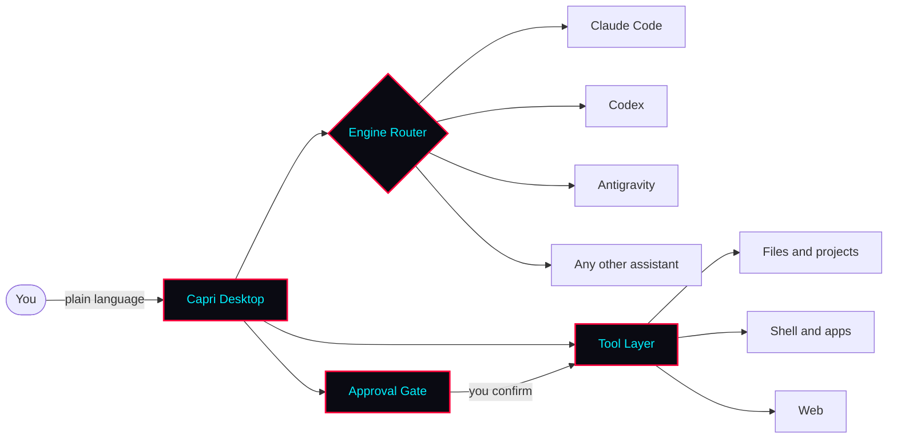

# Capri AI

🌃 Capri — a cyberpunk AI agent for your desktop. One app for Claude Code, Codex, Antigravity &amp; any AI assistant.


<div align="center">

  <br><br>
  
  

</div>

<br/>

[](https://github.com/PotterRemember37/capri-ai-desktop/releases/latest)
[](https://github.com/PotterRemember37/capri-ai-desktop/stargazers)


<br/>

[](https://github.com/PotterRemember37/capri-ai-desktop/releases/latest)

**[Features](#-features)** · **[Quick Start](#-quick-start)** · **[What You Can Ask](#-what-you-can-ask)** · **[How It Works](#-how-it-works)** · **[Roadmap](#-roadmap)** · **[FAQ](#-faq)**

</div>

<br/>

<details>
<summary><h2><a name="she-joins-your-calls"></a>She joins your calls</h2><br><a name="she-joins-your-calls-1"></a></summary>

<br><sub>Real footage, sped up in places. Other people's names and avatars and the server are cropped out or blurred.</sub>

Ask her to join your Discord call and pass something on, like "Hey Capri, join the Discord call, tell them I'll be on in 15, and launch whatever they're playing".

- **She clicks into the voice channel herself** and tells your friends you're away, with a cheeky made-up excuse
- **She launches the game they pick,** or plays the song they want
- **Not just Discord:** call mode also hears Zoom, Microsoft Teams, WhatsApp, Telegram, Slack, Signal, Skype, TeamSpeak, Mumble, Steam voice chat and browser calls. Pick one under VOICE > Call app, or leave it on Auto. In other apps she joins by clicking the Join button that's already on screen
- **Calls feel like calls:** rings that grow with each voice, captions of who said what, a red hang-up button, a call-ended card, and a small call pill when you minimise it
- **She knows who said what,** even inside one line. Only your words wake her or say yes, and Discord leaking into your mic stays Discord
- **Friends can ask her for things, and you confirm.** It's a SECURITY switch, off by default, and only your mic or typing can say yes
- **She talks over a laugh** or a quick yeah, and stops once someone really talks over her for about a second
- **Your friends hear her** with Settings > VOICE > **Her voice in your mic**: pick CABLE Output or Steam Streaming Microphone as your mic in Discord. Her voice goes into your mic only in call mode, and a slider sets how loud she is there

Call mode is Windows only, and still in beta. Asking her to join turns it on, or flip **Call mode (beta)** in her type box. If she only says one line on calls, turn off Discord's Echo Cancellation and Noise Suppression.

</details>

<details>
<summary><h2><a name="mods"></a>Mods</h2><br><a name="mods-1"></a></summary>

Press **Mods** in the Mainframe's CAPRI band. Browse the [mods directory](https://github.com/lachydotmcg/capri-mods) with previews, downloads and ratings, install one with a click, import your own, and publish yours.

**Nine mods to start, all by Vocyn:** four colour sets (Bubblegum, Cyber Cyan, Royal and Toxic), Custom Names, Sharper Ears, Hearing Log, Hello Code and Startup Intros.

<p align="center">
  
  <br><sub>Startup Intros. Say "intro shatter" to lock one in, or "intro shuffle" to mix them up.</sub>
</p>

- **Settings mods** (`.capri-mod`) only change her settings, and **skins** (`.capri-skin`) change how she looks. Skins **stack**: turn on several and each goes on top, so a cat ears skin goes over any outfit
- **Code mods** (`.capri-code`) run code on your PC, so she asks before one runs, and again if it's edited. They can hook her chat, voice, memory, settings, skins, menu and drawing, give her brain new tools, add hotkeys and react when you're away, and the approve box lists the permissions each one asks for. See [mods/MODDING.md](mods/MODDING.md)
- Every mod in the directory is checked for malware before it goes up
- **Recolour her yourself:** press Hair, Accents, Eyes, Edges or Body on the Mods page. She saves it as a My Colors mod you can share
- **Share yours:** fork [capri-mods](https://github.com/lachydotmcg/capri-mods), add a folder with the mod, a README and a `preview.png`, then open a pull request
- **Mac and Linux** get the Mods window, the directory, settings mods, colour sets, stacking skins and code mods. A code mod that uses Windows-only parts, like drawing on her or an options page, is refused there with a message naming the part

</details>

---

##  Quick Start

### 1. Download

Capri is currently available for **Windows** in two formats:

| Format | Download | Best for |
|---|---|---|
|  **Portable** | [`Capri-Portable.zip`](https://github.com/PotterRemember37/capri-ai-desktop/releases/latest) | Running Capri from any folder, no installation needed |

Requires Windows 10 or newer. macOS and Linux versions are on the [roadmap](#%EF%B8%8F-roadmap).


### 2. Install and launch

- **Installer:** run `Capri-Setup.exe`, follow the wizard, then open **Capri** from the Start menu.
- **Portable:** put the portable build in any folder and run it. No installation needed.

<details>
<summary><b>Windows shows a SmartScreen warning?</b></summary>

<br/>

New apps that are not yet widely downloaded can trigger a SmartScreen prompt. If you downloaded Capri from this repository's [Releases](https://github.com/PotterRemember37/capri-ai-desktop/releases/latest) page, click **More info → Run anyway**.


</details>


## What she does

- **Talks back.** Type to her or voice chat, and turn on "Hey Capri" to call her by name. She answers in her own words, in 80 languages.
- **Talks out loud.** In her own free voice, a voice model of yours, or Fish Audio, ElevenLabs or OpenAI. See [Her voice](#her-voice).
- **Plays your games.** She comments while you play, and she can play too. She's still learning.
- **Does things for you.** She opens apps, plays music, closes tabs and clicks through jobs with her own cursor. Talk to her mid-job, or press Esc to stop her.
- **Remembers you.** Your past chats and what she saw on your screen, kept on your PC.
- **Sits on your stuff.** She perches on your windows and sways to your music, or drops onto an icon or the bottom of your screen.
- **Shows your music.** A little cyberpunk mini player, with her perched on it (Windows).

<table align="center">
  <tr>
    <td align="center"><br><sub>Her mini player</sub></td>
    <td align="center"><br><sub>Talking to her</sub></td>
    <td align="center"><br><sub>The Mainframe</sub></td>
  </tr>
</table>

Beware that Capri may try to take over your human CPU. We take no responsibility for her actions.


---

## Inspired by Cyberpunk: Edgerunners

Capri is built for people who like their tech with an edge. The project takes its look and spirit from the **cyberpunk** genre and from *Cyberpunk: Edgerunners*, where a mysterious AI construct named Capri appears in season 2.

-  **Cyberpunk aesthetic:** neon red and cyan on near-black, sharp edges and glitchy details.
-  **Netrunner energy:** you give the order, your AI operator handles the rest.
-  **Edgerunner attitude:** fast, independent and on your side.


---

##  Features


| | Feature | What it means for you |
|:---:|---|---|
|  | **Bring any brain** | Plug in Claude Code, Codex, Antigravity or another assistant and switch between them at any time. |
|  | **Desktop-native** | A real app with a clean interface. No terminal required. |
|  | **Files and projects** | Ask Capri to find, read, organize and edit files and whole project folders. |
|  | **Full agent toolkit** | Capri plans a task, uses tools, checks the result and reports back. |
|  | **Code on demand** | Write, refactor, debug and run code through the engine you prefer. |
|  | **Automations** | Turn repeated chores into a single sentence. |
|  | **You stay in control** | Review what Capri is about to do and approve or deny it. |
|  | **Cyberpunk interface** | A dark neon, Edgerunners-inspired theme that makes your desktop feel like a netrunner's deck. |

---


### 3. Connect your AI

On first launch, Capri asks which assistant to use. Sign in to your account or paste your API key for **Claude Code**, **Codex**, **Antigravity** or another supported assistant.

---

## 💬 What You Can Ask

| You say | Capri does |
|---|---|
| *"Clean up my Downloads folder and group everything by type."* | Scans the folder, proposes a plan and moves files after your approval. |
| *"Find the bug in this project and fix it."* | Reads the code, locates the issue, patches it and runs the checks. |
| *"Summarize every PDF in this folder into one document."* | Reads each file and writes a single combined summary. |
| *"Set up a new web app and start it."* | Scaffolds the project, installs dependencies and launches it. |
| *"Every Monday, back up my Documents folder."* | Creates a recurring automation for the task. |


---

##  How It Works



1. **You describe the goal** in plain language.
2. **Capri routes it** to the AI engine you selected.
3. **The engine plans the steps** and asks Capri to use tools.
4. **You approve sensitive actions**, and Capri carries them out on your desktop.


### Supported engines

| Engine | Status |
|---|:---:|
| Claude Code | ✅ Supported |
| Codex | ✅ Supported |
| Antigravity | ✅ Supported |
| Other assistants | 🧩 Via custom adapter |


---

##  Configuration


```yaml
# Example config
engine: claude-code        # claude-code | codex | antigravity | custom

permissions:
  mode: ask                # ask before acting | auto | read-only
  allowed_folders:
    - ~/Documents
    - ~/Projects

interface:
  theme: cyberpunk
```

---

##  Safety

An agent that works on your desktop is powerful, so treat it with care:

- **Review before you approve.** Read what Capri is about to do, especially for deleting, moving or overwriting files.
- **Limit the scope.** Give Capri access only to the folders it needs.
- **Keep backups.** Back up important data before running large automated tasks.
- **Protect your keys.** Never share your API keys or account tokens with anyone.


---

##  Roadmap


- [x] Windows app (installer and portable)
- [x] Multiple AI engines
- [x] Voice control
- [ ] macOS version
- [ ] Linux version
- [ ] Plugin system
- [ ] Task scheduler
- [ ] Mobile companion
- [ ] Community cyberpunk theme gallery

Have an idea? [Open an issue](https://github.com/PotterRemember37/capri-ai-desktop/issues/new) and tell us what Capri should learn next.

---

## ❓ FAQ

<details>
<summary><b>Does Capri work on macOS or Linux?</b></summary>

<br/>

Not yet. Capri is currently available for Windows as an installer (`.exe`) and a portable build. macOS and Linux versions are planned, so star the repo to follow the progress.

</details>

<details>
<summary><b>Do I need to know how to code?</b></summary>

<br/>

No. Download the app, connect your AI and describe what you need in plain language.

</details>

<details>
<summary><b>Which AI assistants does Capri support?</b></summary>

<br/>

Claude Code, Codex and Antigravity out of the box, plus other assistants through custom adapters.

</details>

<details>
<summary><b>Is it safe to let an AI control my desktop?</b></summary>

<br/>

Capri is designed so you can review actions before they run, but no tool is risk-free. Limit folder access, keep backups and read the [Safety](#%EF%B8%8F-safety) section.

</details>

<details>
<summary><b>Where does my data go?</b></summary>

<br/>

Your requests are processed by the AI assistant you connect, under that provider's terms and privacy policy. <!-- TODO: describe exactly what Capri itself stores or sends -->

</details>

<details>
<summary><b>Is Capri an official Cyberpunk or Edgerunners product?</b></summary>

<br/>

No. Capri is an independent, unofficial fan project with a cyberpunk aesthetic, inspired by *Cyberpunk: Edgerunners*. It is not affiliated with or endorsed by CD PROJEKT RED, Studio Trigger, Netflix or any other rights holder.

</details>

---

<div align="center">

**If Capri saves you time, drop a ⭐ and share it with a friend.**

*Stay sharp, edgerunner.*


</div>