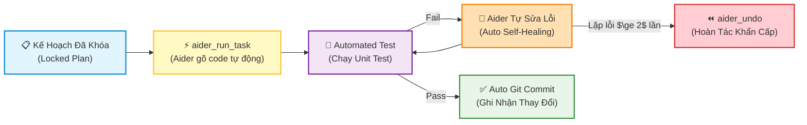

# ⚡ AIDER EXECUTION ENGINE — MCP AUTOMATED CODING OPERATOR

> **Động cơ thực thi (Execution Engine)**: `Aider CLI` via MCP Protocol (`mcp_server_aider.py`)  
> **Mô hình AI Hỗ trợ (Supported Models)**: `gemini/gemini-3.6-flash`, `gemini/gemini-3.5-flash`  
> **Quy trình Cốt lõi**: `Vibe Coding khép kín` $\to$ `Tự động Commit Git` $\to$ `Tự động Chạy Unit Test` $\to$ `Tự sửa lỗi (Self-Healing)`.

---

## 🏛️ 1. TỔNG QUAN KIẾN TRÚC & QUY TRÌNH TỰ ĐỘNG HÓA

Aider Execution Engine cung cấp cầu nối tự động hóa gõ code trực tiếp, bảo đảm mã nguồn được kiểm thử liên tục:

---

## 🛠️ 2. BẢNG CÔNG CỤ MCP SERVER (`mcp_server_aider.py`)

1. **`aider_run_task(prompt, cwd, model, test_cmd, files)`**:
   * *Mục tiêu*: Giao nhiệm vụ cho Aider viết code hoặc tái cấu trúc tự động.
   * *Cờ quan trọng*:
     - `test_cmd`: Câu lệnh kiểm thử tự động (ví dụ: `npm test` hoặc `pytest`). Aider sẽ tự động chạy test sau mỗi lượt sửa và tiếp tục sửa nếu test fail!
     - `model`: Chỉ định mô hình AI hiệu năng cao (`gemini/gemini-3.6-flash`).
2. **`aider_undo(cwd)`**:
   * *Mục tiêu*: Nút bấm hoàn tác khẩn cấp (`Emergency Rollback`). Lập tức đảo ngược commit gần nhất nếu phát hiện Aider đi lạc hướng hoặc lặp lỗi.
3. **`aider_get_repomap(cwd)`**:
   * *Mục tiêu*: Trích xuất bản đồ cây cú pháp nén của toàn bộ dự án từ Tree-sitter.
4. **`aider_get_status(cwd)`**:
   * *Mục tiêu*: Kiểm tra nhanh trạng thái `git status` và lịch sử commit gần nhất của Aider.

---

## 📋 3. QUY TRÌNH VẬN HÀNH CHUẨN 3 BƯỚC (RUNBOOK)

1. **Bước 1 — Khóa Kế Hoạch & Xác Định Ranh Giới (`Lock Plan & Scope`)**:
   * Định vị danh sách file cần sửa, lập chỉ mục AST trước khi kích hoạt Aider.
2. **Bước 2 — Điều Phối Aider Chạy Kèm Lệnh Test (`Execute with Auto-Test`)**:
   * Luôn truyền tham số `test_cmd` để khép kín vòng lặp kiểm chứng thực tế.
3. **Bước 3 — Nghiệm Thu & Khắc Phục Khẩn Cấp (`Verification & Circuit Breaker`)**:
   * Nếu Aider sửa thành công và test xanh $\to$ Tiếp nhận commit.
   * Nếu Aider bị rơi vào vòng lặp sửa sai $\ge 2$ lần $\to$ Gọi ngay `aider_undo` để phục hồi trạng thái sạch, sau đó tinh chỉnh lại prompt.

---

## 🛡️ 4. NGUYÊN TẮC BẤT BIẾN (INVARIANTS)

1. **Kỷ Luật Thuật Ngữ Song Ngữ (`Bilingual Terminology Protocol`)**:
   * Mọi tài liệu và trao đổi phải tuân thủ nghiêm ngặt định dạng: **`English (Tiếng Việt)`** *(Ví dụ: `Automated Rollback (Hoàn Tác Tự Động)`, `Continuous Integration (Tích Hợp Liên Tục)`)*.
2. **Quy Tắc Ngắt Lặp Lỗi 2 Lần (`Two-Strike Circuit Breaker`)**:
   * Tuyệt đối không cho phép Aider tự thử sai quá 2 lần với cùng một lỗi lặp lại. Phải dừng tiến trình, rollback và phân tích nguyên nhân gốc rễ.
