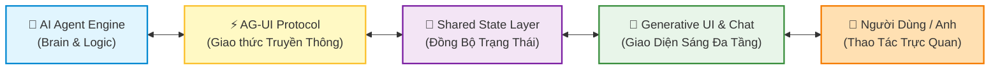

# 🤖 COPILOTKIT — THE FRONTEND STACK FOR AGENTS & GENERATIVE UI

> **Nguồn gốc (Origin)**: Kho lưu trữ mã nguồn mở `CopilotKit/CopilotKit` (37.349 ⭐)  
> **Sứ mệnh cốt lõi (Mission)**: Cung cấp giải pháp Frontend toàn diện cho Tác tử AI và Giao diện Sinh Tự động (`Generative UI`)  
> **Giao thức Chuẩn mực**: `AG-UI Protocol (Giao thức Giao diện Tác tử)`  
> **Nguyên tắc vận hành**: Chuẩn song ngữ `English (Tiếng Việt)`, tuân thủ `Luminous Light Theme Invariant`.

---

## 🏛️ 1. BẢN CHẤT KIẾN TRÚC & CÁC TRỤ CỘT CỐT LÕI (CORE CAPABILITIES)

CopilotKit kết nối trực tiếp bộ não AI với các thành phần giao diện người dùng trên web theo mô hình hai chiều (`Bi-Directional Bridge`):



### Các Khả Năng Vượt Trội:
1. **Chat UI & Streaming Interface (Giao Diện Trò Chuyện & Luồng Dữ Liệu)**: Giao diện chat có thể tùy biến toàn diện, hỗ trợ luồng tin nhắn trực tiếp (`Message Streaming`), gọi công cụ (`Tool Calls`) và phản hồi theo thời gian thực.
2. **Generative UI (Giao Diện Sinh Tự Động Theo Ngữ Cảnh)**: Cho phép Tác tử AI tự động dựng và cập nhật các thẻ Component trực quan dựa trên ý định của người dùng và trạng thái của Agent.
3. **Shared State Layer (Tầng Đồng Bộ Trạng Thái Chung)**: Đồng bộ hóa hai chiều giữa Agent và các React Components, cho phép AI đọc/ghi trực tiếp vào State ứng dụng.
4. **Human-in-the-Loop (Phê Duyệt Có Con Người Tham Gia)**: Cơ chế tạm dừng để chờ Anh phê duyệt trước khi kích hoạt các hành động thay đổi dữ liệu quan trọng.

---

## 🛠️ 2. CÚ PHÁP LỆNH & VÍ DỤ TRIỂN KHAI (IMPLEMENTATION GUIDE)

```bash
# Cài đặt gói thư viện cốt lõi
npm install @copilotkit/react-core @copilotkit/react-ui
```

### Triển khai Khung Tác Tử Đồng Bộ Trạng Thái (`Shared State Component`):
```tsx
import { useAgent } from "@copilotkit/react-core";

export function AgentStatusCard() {
  // Kết nối và điều khiển Agent thông qua hook useAgent
  const { agent } = useAgent({ agentId: "lead_architect_agent" });

  return (
    <div className="p-4 rounded-xl bg-white border border-black/5 shadow-sm">
      <h3 className="font-semibold text-slate-800">Trạng thái Tác tử: {agent.state.currentTask}</h3>
      <button
        onClick={() => agent.setState({ status: "ACTIVE" })}
        className="mt-2 px-4 py-2 bg-slate-900 text-white rounded-lg active:scale-95 transition-transform"
      >
        Kích Hoạt Tác Tử
      </button>
    </div>
  );
}
```

---

## 🛡️ 3. NGUYÊN TẮC BẢO MẬT & BẤT BIẾN THẨM MỸ (INVARIANTS)

1. **Quy Chuẩn Giao Diện Sáng Đa Tầng Luminous (`Luminous Light Theme Invariant`)**:
   * Mọi hộp thoại chat, thẻ tương tác và Generative UI dựng bởi CopilotKit **MẶC ĐỊNH 100% SỬ DỤNG GIAO DIỆN NỀN SÁNG ĐA TẦNG**. Nền trắng sứ/ngà mịn màng kết hợp viền mờ cao cấp, tuyệt đối không tự ý dùng Dark Theme.
2. **Kỷ Luật Thuật Ngữ Song Ngữ (`Bilingual Terminology Protocol`)**:
   * Mọi lời thoại giải thích và tài liệu bắt buộc tuân theo định dạng: **`English (Tiếng Việt)`** *(Ví dụ: `Event Streaming (Luồng Sự Kiện)`, `State Synchronization (Đồng Bộ Trạng Thái)`)*.
