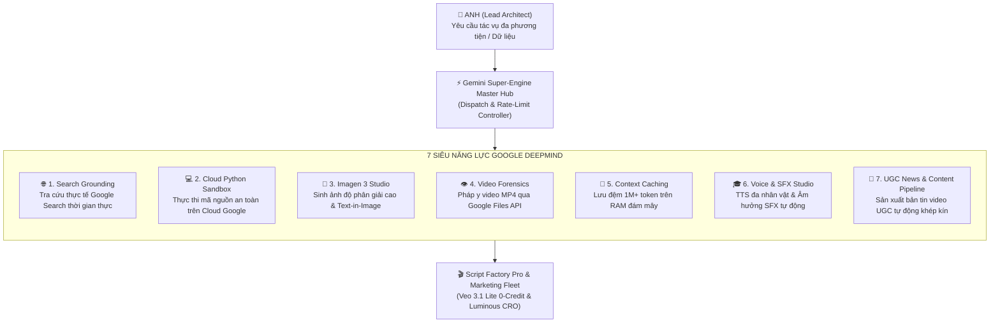

# 🚀 GEMINI SUPER-ENGINE — MASTER ARCHITECTURE & OPERATIONS SPECIFICATION

> **Chủ quản Tối cao (Owner)**: Anh — Lead Architect / Product Owner  
> **Cộng sự AI Vận hành (Executive AI Agent)**: Em — Senior Engineering Agent & DeepMind Engine Operator  
> **Nền tảng Cốt lõi (Core Stack)**: Google DeepMind & Google AI Studio API (`gemini-2.5-flash`, `imagen-3.0-generate-002`, `code_execution`)  
> **Nguyên tắc Vận hành**: Chuẩn song ngữ `English (Tiếng Việt)`, tuân thủ `0-Credit Video Invariant` & `Luminous Light Theme Invariant`.

---

## 🗺️ 1. TỔNG QUAN 7 SIÊU NĂNG LỰC DEEPMIND (THE 7 SUPERPOWERS)

Hệ thống **Gemini Super-Engine** là bộ mở rộng năng lực toàn diện cho Antigravity 2.0, kết nối trực tiếp với hạ tầng siêu tính toán của Google:

---

## 🛠️ 2. BẢN ĐỒ PHÂN HỆ VÀ CẨM NANG LỆNH THỰC THI (CLI RUNBOOK)

Tất cả các công cụ sản xuất đều nằm tại thư mục: `C:\Users\SAS\.gemini\config\skills\gemini-super-engine\scripts\`

| Phân Hệ | File Thực Thi (`Script`) | Mô Hình AI | Cú Pháp Lệnh CLI Tiêu Chuẩn (`CLI Command`) |
| :--- | :--- | :--- | :--- |
| **🌐 Search Grounding** | `google_search_grounding.py` | `gemini-2.5-flash` | `python .../google_search_grounding.py --query "Nội dung cần tra cứu"` |
| **💻 Cloud Python Sandbox** | `cloud_code_executor.py` | `code_execution` | `python .../cloud_code_executor.py --code "print(2**64)"` |
| **🎨 Imagen 3 Studio** | `imagen_studio_engine.py` | `imagen-3.0-generate-002` | `python .../imagen_studio_engine.py --prompt "Prompt chi tiết" --aspect-ratio 16:9 -o "output.png"` |
| **👁️ Video Forensics** | `native_video_forensics.py` | `gemini-2.5-flash` + Files API | `python .../native_video_forensics.py -v "path/to/video.mp4" --prompt "Phân tích kịch bản từng giây"` |
| **🎥 YouTube Summarizer** | `youtube_summarizer.py` | `gemini-2.5-flash` | `python .../youtube_summarizer.py --url "https://youtu.be/..." --language vi` |
| **🎵 SFX Studio Mixer** | `sfx_studio_mixer.py` | Media Audio Engine | `python .../sfx_studio_mixer.py --scene "storm" --output "ambient.mp3"` |
| **⚡ UGC News Generator** | `render_ugc_news_video_turbo.py`| Gemini + FFmpeg | `python .../render_ugc_news_video_turbo.py --topic "Tin tức mới" --output "news.mp4"` |
| **🧪 Automated Test Suite** | `test_super_engine_suite.py` | Full Engine Probe | `python .../test_super_engine_suite.py --all` |

---

## 🎙️ 3. KHO ÂM THANH HIỆU ỨNG (SFX VAULT)

Hệ thống tích hợp sẵn kho âm thanh điện ảnh tại `sfx_vault/` phục vụ ghép nối video tự động:
* `breaking_news_jingle.mp3`: Đoạn nhạc chuông mở đầu bản tin nóng thời sự.
* `cinematic_swoosh.mp3`: Âm thanh chuyển cảnh điện ảnh tốc độ cao.
* `heavy_rain.mp3`: Âm thanh mưa giông thực tế môi trường bão lũ.
* `thunder_strike.mp3`: Âm thanh sấm sét vang rền uy lực.

---

## 🔒 4. CÁC NGUYÊN TẮC BẢO MẬT & BẤT BIẾN KIẾN TRÚC (ARCHITECTURAL INVARIANTS)

1. **Bảo Mật Khóa API Tuyệt Đối (`API Key Zero-Leak Invariant`)**:
   * Khóa API chính thức được nạp độc quyền từ biến môi trường `GEMINI_API_KEY` hoặc file an toàn `C:\Users\SAS\.gemini\config\sidecars\anti_live_voice\.env.local`.
   * Tuyệt đối không bao giờ hardcode khóa API vào mã nguồn hoặc file tài liệu công khai.
2. **Quy Chuẩn Video 0-Credit Bắt Buộc (`0-Credit Video Strict Invariant`)**:
   * Khi phân hệ kết hợp với `Script Factory Pro` để chuyển prompt sang video render, **BẮT BUỘC KHÓA CỨNG 100% MODEL `Veo 3.1 - Lite [Lower Priority]` (định danh host: `veo_3_1_lite_low_priority`)**.
   * Đảm bảo không bao giờ làm cạn kiệt Paid Credits hoặc khiến server Google Flow treo request ngầm (`Silent Hanging Promise`).
3. **Quy Chuẩn Giao Diện Sáng Đa Tầng Luminous (`Luminous Light Theme Invariant`)**:
   * Mọi tài sản hình ảnh do Imagen 3 tạo cho giao diện web, tài liệu thuyết trình hoặc trang đích thương mại phải mang phong cách ánh sáng tự nhiên, nền sáng đa tầng cao cấp, triệt tiêu giao diện tối đen (`Dark Theme`) trừ khi Anh chỉ định rõ ràng.
4. **Cơ Chế Điều Tiết Nhịp & Khắc Phục Lỗi Giới Hạn Hạn Mức (`Rate-Limit & Free-Tier Governance`)**:
   * Tận dụng tối ưu hạn ngạch miễn phí 1.500 requests/ngày của gói Google AI Studio Free Tier.
   * Khi gặp mã lỗi `429 Too Many Requests`, tự động áp dụng thuật toán `Exponential Backoff with Jitter (Lùi số mũ kèm độ trễ ngẫu nhiên)` để bảo đảm luồng dữ liệu không bị ngắt quãng.
5. **Kỷ Luật Thuật Ngữ Song Ngữ (`Bilingual Terminology Protocol`)**:
   * Mọi báo cáo phân tích, tài liệu kỹ thuật và kết quả bàn giao phải tuân thủ chuẩn: **`English (Tiếng Việt)`** *(Ví dụ: `Grounding Verification (Kiểm chứng Cơ sở Dữ liệu)`, `Inference Latency (Độ trễ Suy luận)`)*.
