# 📋 GITHUB SPEC KIT — SPEC-DRIVEN DEVELOPMENT ARCHITECT (SDD)

> **Phương pháp luận (Methodology)**: `Spec-Driven Development (Phát triển dựa trên Đặc tả - SDD)`  
> **Bộ công cụ (Toolchain)**: `specify CLI` + `Aider MCP Execution Engine`  
> **Nguyên tắc vận hành**: `Contract-First (Khế ước đi trước)`, `Zero Ambiguity (Triệt tiêu mơ hồ)`, chuẩn song ngữ `English (Tiếng Việt)`.

---

## 🏛️ 1. TỔNG QUAN KIẾN TRÚC & QUY TRÌNH SDD (SDD LIFECYCLE)

Quy trình **Spec-Driven Development (Phát triển theo Đặc tả - SDD)** chuyển hóa các ý tưởng kinh doanh hoặc tính năng phức tạp thành các văn kiện đặc tả kỹ thuật chuẩn tắc trước khi bất kỳ dòng code nào được viết ra:

```mermaid
flowchart LR
    A["💡 Ý Tưởng Thô<br/>(Raw Concept)"] --> B["📜 Constitution<br/>(Hiến Pháp Dự Án)"]
    B --> C["📋 Specification<br/>(Đặc Tả spec.md)"]
    C --> D["📐 Master Plan<br/>(Kế Hoạch plan.md)"]
    D --> E["✅ Task Matrix<br/>(Phân Rã tasks.md)"]
    E --> F["⚡ Aider Engine<br/>(Code & Auto-Test)"]

    style A fill:#e1f5fe,stroke:#0288d1,stroke-width:2px;
    style B fill:#fff9c4,stroke:#fbc02d,stroke-width:2px;
    style C fill:#f3e5f5,stroke:#7b1fa2,stroke-width:2px;
    style D fill:#ffe0b2,stroke:#f57c00,stroke-width:2px;
    style E fill:#e8f5e9,stroke:#388e3c,stroke-width:2px;
    style F fill:#ede7f6,stroke:#512da8,stroke-width:2px;
```

---

## 🛠️ 2. BẢNG LỆNH ĐIỀU PHỐI CỐT LÕI (CORE CLI RUNBOOK)

| Giai Đoạn | Cú Pháp Lệnh CLI (`Command Syntax`) | Mục Tiêu & Sản Phẩm Đầu Ra (`Deliverable Artifact`) |
| :--- | :--- | :--- |
| **0. Khởi tạo Dự án** | `specify init . --integration gemini --force --ignore-agent-tools` | Thiết lập khung cấu trúc `.specify/` và template đặc tả chuẩn cho Antigravity 2.0. |
| **1. Lập Hiến Pháp** | `specify constitution` | Định hình `constitution.md`: 8 Quy tắc vàng, Tiêu chuẩn an ninh, Ranh giới kiến trúc. |
| **2. Đặc Tả Yêu Cầu** | `/speckit.specify [mục tiêu tính năng]` | Soạn thảo `spec.md`: User stories, Boundary conditions (Điều kiện biên), Acceptance criteria. |
| **3. Thiết Kế Kiến Trúc**| `/speckit.plan` | Lập `plan.md`: Sơ đồ dữ liệu, AST interface contracts, Component breakdown, Tech stack. |
| **4. Phân Rã Công Việc** | `/speckit.tasks` | Sinh `tasks.md`: Danh sách Work Packages tuần tự hoặc song song, định danh task ID độc lập. |
| **5. Thực Thi Khép Kín** | `/speckit.implement [task_id]` | Kích hoạt `aider-execution-engine` qua MCP: Tự gõ code, Auto-Commit Git và chạy Unit Test. |

---

## ⚡ 3. NGUYÊN TẮC VÀNG BẢO TOÀN KIẾN TRÚC (ARCHITECTURAL INVARIANTS)

1. **Khế Ước Bất Biến Trước Khi Viết Code (`Contract-First Invariant`)**:
   * Tuyệt đối không sinh mã nguồn (`Source Code`) khi chưa đóng băng file đặc tả `spec.md` và bảng phân nhiệm `tasks.md`.
2. **Kỷ Luật Thuật Ngữ Song Ngữ (`Bilingual Terminology Protocol`)**:
   * Mọi tài liệu đặc tả và hướng dẫn bắt buộc tuân thủ định dạng: **`English (Tiếng Việt)`** *(Ví dụ: `Interface Contract (Khế ước Giao diện)`, `Regression Testing (Kiểm thử Hồi quy)`)*.
3. **Phối Hợp Aider MCP An Toàn (`Aider MCP Safety Sandbox`)**:
   * Khi kích hoạt `/speckit.implement`, Aider phải chạy kèm cờ `--test-cmd` để tự động kiểm chứng và gọi `aider_undo` ngay lập tức nếu phát hiện mã nguồn bị lặp lỗi hồi quy (`Regression Loop`).
