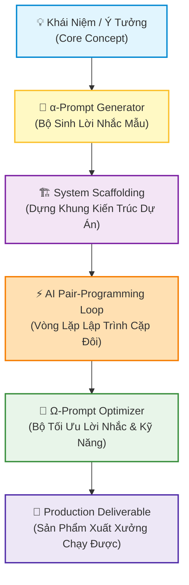

# 🚀 VIBE CODING PRO — MASTER AI PAIR-PROGRAMMING RUNBOOK

> **Nguồn gốc (Origin)**: Kho lưu trữ mã nguồn mở `tradecatlabs/vibe-coding-cn` (16.237 ⭐)  
> **Phương pháp luận (Methodology)**: `Vibe Coding (Lập trình Trực giác Dựa trên Luồng Ý Thức)`  
> **Mục tiêu tối thượng**: Biến mọi ý tưởng thô thành sản phẩm phần mềm ổn định, chạy được trong thời gian ngắn nhất  
> **Nguyên tắc vận hành**: Chuẩn song ngữ `English (Tiếng Việt)`, bám sát `Evidence Ledger (Sổ cái Bằng chứng)`.

---

## 🏛️ 1. BẢN CHẤT KIẾN TRÚC & TRIẾT LÝ CỐT LÕI (CORE PHILOSOPHY)

Phương pháp luận **Vibe Coding** định hình lại mối quan hệ giữa Lập trình viên và AI, chuyển đổi từ "người gõ từng dòng code" sang "Tổng công trình sư điều phối ý định (`Intent Architect`)":

### 3 Trụ Cột Triết Lý Bất Biến:
1. **Khái Niệm là Cửa Vào (`Concept is the Portal`)**: Nếu không nắm rõ bản chất khái niệm kiến trúc, bạn sẽ không thể nhìn thấy, chạm tới hoặc điều phối được đối tượng mã nguồn.
2. **Chỉ Dùng Mô Hình Mạnh Nhất (`Frontier Models Only`)**: Vibe Coding đòi hỏi năng lực suy luận kịch trần (`Max Reasoning`), ưu tiên các mô hình mạnh nhất để hạn chế ảo giác (`Hallucination`).
3. **Kết Quả Thực Tế Làm Thước Đo (`Outcome-Driven Deliverables`)**: Mọi dòng code sinh ra phải được kiểm chứng bằng runtime thực tế, không chấp nhận khẳng định suông.

---

## 🧬 2. CẶP MA TRẬN LỜI NHẮC MẸ (THE DUAL MOTHER-PROMPT ENGINES)

Hệ thống vận hành dựa trên 2 cỗ máy lời nhắc tự thân:
* **$\alpha$-Prompt (Alpha Generator — Cỗ máy Mẹ Sinh Lời Nhắc)**:
  * *Nhiệm vụ*: Lấy mục tiêu người dùng làm đầu vào, tự động phân tích không gian bài toán và sinh ra các bộ Prompt chuyên biệt, kịch bản kiểm thử hoặc System Instructions mới.
* **$\Omega$-Prompt (Omega Optimizer — Cỗ máy Mẹ Tối Ưu Hóa)**:
  * *Nhiệm vụ*: Kiểm toán các prompt, quy trình làm việc (`Workflows`) hoặc file kỹ năng (`Skills`) hiện có, loại bỏ các điểm mơ hồ, tối ưu hóa độ súc tích của Token và tăng tỷ lệ thành công của tác vụ lên mức tối đa.

---

## 🛠️ 3. QUY TRÌNH VẬN HÀNH 4 BƯỚC KHÉP KÍN (STANDARD 4-STEP RUNBOOK)

1. **Bước 1 — Định Vị Không Gian Khái Niệm (`Conceptual Scoping`)**:
   * Khảo sát môi trường và xác định rõ miền vấn đề: runtime tương thích (Node.js / Python / Docker) trên máy trạm Windows.
2. **Bước 2 — Thiết Lập Khung Thử Nghiệm Tối Giản (`Minimal Sandbox Scaffolding`)**:
   * Tạo môi trường cô lập, nạp biến môi trường an toàn và khởi tạo dự án với quy mô tối thiểu (`FAST Mode`).
3. **Bước 3 — Vòng Lặp Lập Trình Trực Giác Cặp Đôi (`Iterative Vibe Loop`)**:
   * Chia nhỏ công việc thành các bước lặp 15–30 giây, kiểm tra trực quan ngay trên trình duyệt hoặc terminal, sửa lỗi theo phản hồi tức thì (`Real-Time Feedback`).
4. **Bước 4 — Kiểm Chứng & Xuất Sổ Cái Bằng Chứng (`Evidence Ledger Verification`)**:
   * Chạy unit tests hoặc kiểm chứng tương tác end-to-end, ghi nhận kết quả vào sổ cái bằng chứng trước khi bàn giao cho Anh.

---

## 🛡️ 4. CÁC NGUYÊN TẮC AN TOÀN BẤT BIẾN (SAFETY GUARDRAILS)

1. **Kỷ Luật Song Ngữ Bắt Buộc (`Bilingual Terminology Protocol`)**:
   * Toàn bộ lời thoại, tài liệu kỹ thuật và giải thích phải tuân thủ nghiêm ngặt định dạng: **`English (Tiếng Việt)`** *(Ví dụ: `Context Compaction (Nén Ngữ Cảnh)`, `State Machine (Máy Trạng Thái)`)*.
2. **Bảo Mật Thông Tin Định Danh Tuyệt Đối (`Credential Isolation`)**:
   * Không bao giờ hardcode token, khóa API hay thông tin xác thực vào mã nguồn công khai.
3. **Quy Chuẩn Giao Diện Sáng Đa Tầng Luminous (`Luminous Light Theme Invariant`)**:
   * Mọi giao diện web, dashboard hoặc prototype sinh ra trong quá trình Vibe Coding phải mặc định 100% sử dụng nền sáng đa tầng cao cấp, triệt tiêu Dark Mode trừ khi có chỉ đạo riêng của Anh.
